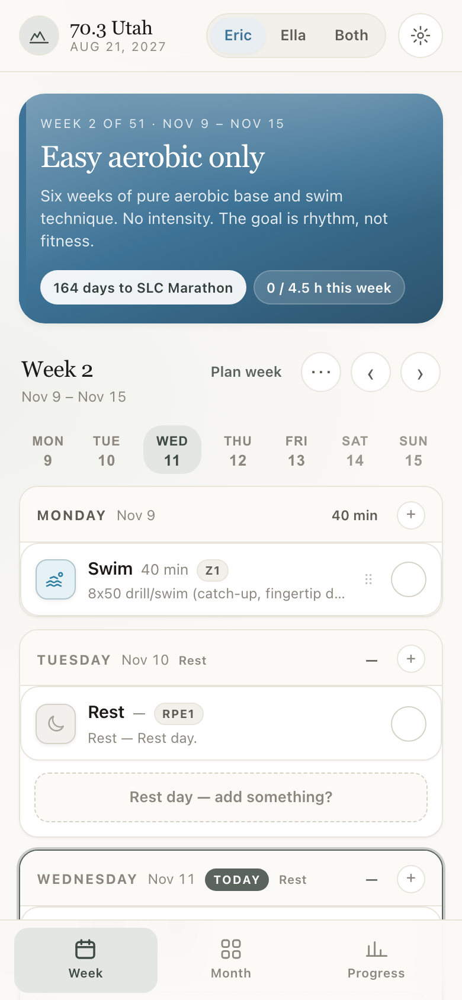
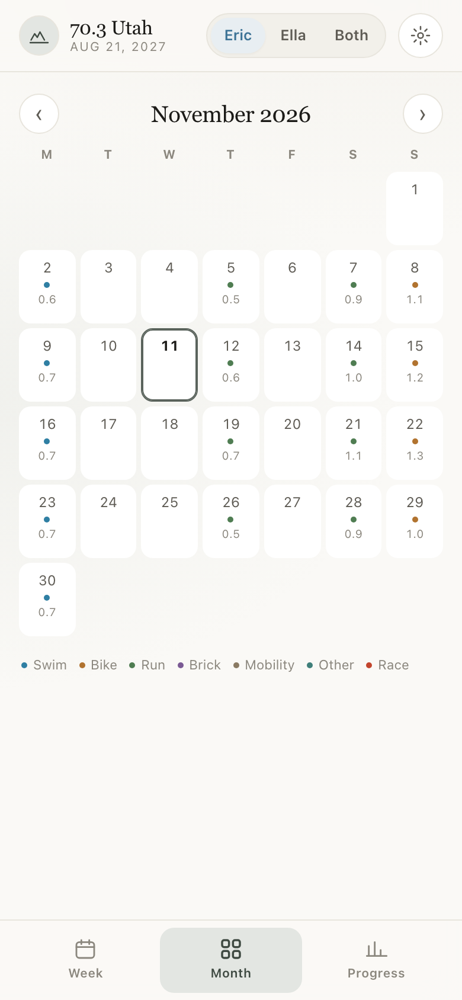
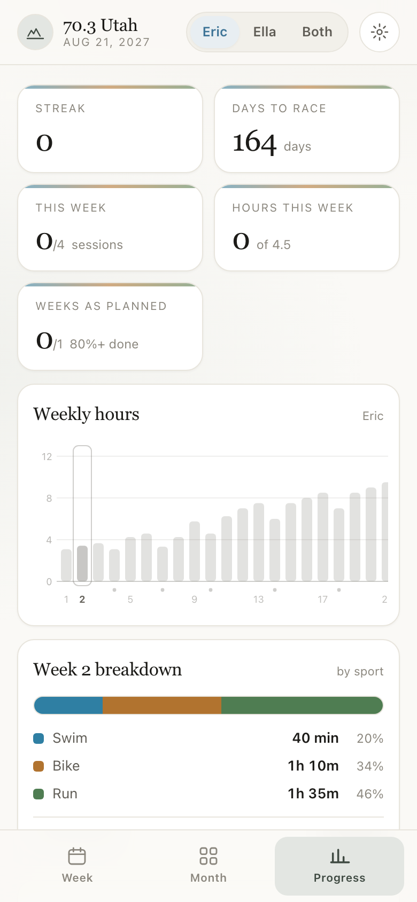
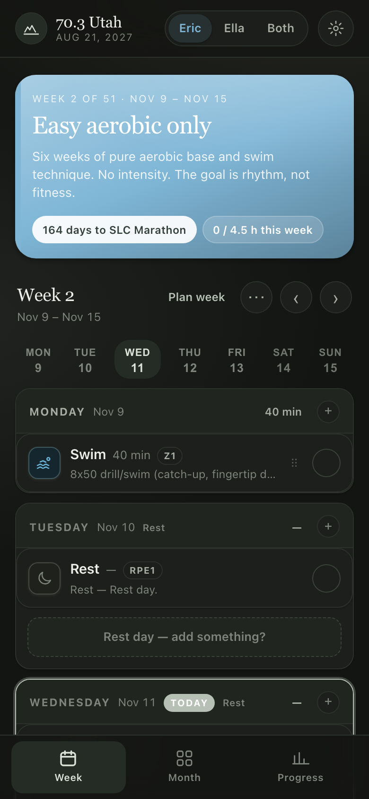

# Ironman 70.3 Utah — Eric & Ella

A 51-week training plan for **Ironman 70.3 Utah, Saturday Aug 21 2027**, with a
mobile-first web app to read it, check things off, and move sessions around.

No time goal. The goal is to **finish comfortably**.

```
Start:  Mon Nov 2 2026
70.3:   Sat Aug 21 2027
Also:   Sat Apr 24 2027  — Ella runs the SLC Marathon
CIM:    Sun Oct 24 2027  — "B" race for both
```

**Tech:** vanilla JavaScript, no framework and no build step · offline-first
service worker · localStorage persistence · mobile-first at 390 px ·
drag-and-drop week planning · `.ics` calendar export · optional Turso sync.

## Screenshots

<p align="center">
  
  
  
</p>

<p align="center"><em>Week, Month and Progress views at 390 px. Dark theme below.</em></p>

<p align="center">
  
</p>

---

## Run it

The app loads `plan.json` with `fetch()`, which browsers block on `file://`.
So serve the folder over HTTP:

```bash
cd ~/Documents/ironman
python3 -m http.server 8080
```

Then open <http://localhost:8080>.

### Put it on your phone

1. Make sure the phone is on the same Wi-Fi as the computer.
2. Find the computer's local IP: `ipconfig getifaddr en0`
3. On the phone, open `http://<that-ip>:8080`
4. Safari → Share → **Add to Home Screen**. Chrome → menu → **Install app**.

It then runs full-screen and works offline (service worker caches everything).
The live copy is also deployed from GitHub `main` through Cloudflare Pages.

> **This public build is local-only.** Each device keeps its own checkmarks,
> moves and notes in `localStorage`. There is no server and no account. Optional
> cross-device sync is configured outside this repo — see
> [Optional sync](#optional-sync-private).

---

## What's in here

| File | What it is |
|---|---|
| `plan.json` | **The plan.** 51 weeks × 7 days × 2 athletes. Source of truth. |
| `index.html` | Page shell. No secrets — the public build is local-only. |
| `css/style.css` | All styling and themes (Auto / Light / Dark / Vibrant / Bloom). |
| `js/store.js` | **Persistence.** localStorage, with optional Turso sync. |
| `js/plan.js` | Loads the plan, applies moves/edits, answers "what's on today?". |
| `js/ui.js` | Rendering. Pure functions that return DOM nodes. |
| `js/cal.js` | `.ics` export for races and workouts. |
| `js/app.js` | State, views, sheets, drag-and-drop, event handlers. |
| `sw.js` | Service worker — offline cache. |
| `tools/build_plan.py` | Generated the original plan. **Do not run it now.** |
| `tools/smoke_test.mjs` | Headless-browser check that the app still works. |

### ⚠️ About `tools/build_plan.py`

It generated the first version of `plan.json`. **`plan.json` is now the source
of truth.** Running the script again overwrites hand edits. `extend_plan.py`
generated weeks 43–51 and aborts if those weeks already exist.

### Checking nothing broke

There is no build step, so a typo can quietly kill a button. Run:

```sh
node tools/smoke_test.mjs
```

It opens the app in headless Chrome, clicks Plan week, assigns workouts, moves
them with the ⠿ grip, restores plan days, and switches athletes — 33 checks,
about 15 seconds. It uses a throwaway browser profile and blocks Turso, so it
never touches your real data.

Use it before you push, and after pulling someone else's changes. Add
`SMOKE_URL=https://your-site` to point it at a deployed copy instead of local
files (best effort — the live site has real saved state).

---

## How the data model works

Four layers, kept separate on purpose:

```
1. TEMPLATE      plan.json or an imported plan    never changed by normal use
2. YOUR EDITS    localStorage (+ optional sync)   moves, edits, extras, week scaling
3. COMPLETIONS   localStorage (+ optional sync)   checkmarks + optional log
4. DEVICE PREFS  localStorage only                theme, "this phone belongs to"
```

Layers 2 and 3 are **overrides**, not rewrites:

- "Reset to original plan" always works.
- You can move a workout and still see where it started.
- Nothing is destroyed by accident.

Themes and the `me` setting stay on each phone on purpose. Everything about the
plan (checkmarks, moves, added workouts, weekly layouts, notes) lives in
`localStorage`; if you enable optional sync, those layers also travel between
devices.

### `plan.json` shape

```jsonc
{
  "planVersion": "3.0",
  "startDate": "2026-11-02",
  "raceDate": "2027-08-21",
  "athletes": { "eric": {...}, "ella": {...} },
  "zones":    { "Z1": {...}, ... },
  "events":   [ {...} ],                 // races + milestones
  "phases":   [ {...} ],
  "weeks": [
    {
      "weekNumber": 1,
      "startDate": "2026-11-02",
      "endDate": "2026-11-08",
      "phase": "base",
      "recoveryWeek": false,
      "targetHours": { "eric": 4, "ella": 4 },
      "focus": "Easy aerobic only",
      "days": [
        {
          "date": "2026-11-02",
          "dayOfWeek": "monday",
          "sessions": [
            {
              "id": "w01-mon-swim1",          // stable — checkmarks key off this
              "discipline": "swim",           // swim | bike | run | brick | strength | cross | rest | race
              "athletes": ["eric", "ella"],
              "duration": 35,                 // minutes
              "intensity": "Z1",
              "sets": "8x50 drill/swim …",
              "notes": "Technique focus…",
              "together": true,
              "variants": {
                "eric": { "duration": 35, "sets": "…", "notes": "…" },
                "ella": { "duration": 40, "sets": "…", "notes": "…" }
              }
            }
          ]
        }
      ]
    }
  ]
}
```

A **shared session is one object** with one `id`, plus a `variants` block for
whatever differs per athlete. That keeps "we're doing this together" honest.

### Importing your own plan

Settings → **Your plan** → **Import plan**. It accepts a `plan.json` with a
`startDate` and a `weeks` array. The built-in plan stays one tap away under
**Use built-in plan**, and **Download plan** gives you the current file to edit.

---

## Moving training days around

There are now four levels, from quick to permanent:

| You want | Where |
|---|---|
| Reshuffle this week | Week header → **Plan week** → tap a workout, then tap a day. |
| Drag one workout | Hold the **⠿** handle on a week card and drag it onto another day. |
| Shift one session | Session → **Move** → tap a day. Choose *Both / Eric / Ella*. |
| Change one session | Session → **Edit** → duration, zone, sets, notes. |
| Add something | **+** in a day header, or tap a rest day and use **Quick add**. |
| Hide a sport for a day | **Plan week → Weekly layout** |
| Ease off a whole week | Week options → **Scale volume** (70–110%). |

Moving a shared session moves it for both by default. Switch the scope to one
person if only one of you is shifting.

The original plan never changes. Every move is an override you can reset from
the session sheet.

### Logging what actually happened

Tap the check circle → enter actual minutes, RPE and a note. To change the
minutes later, tap the same check again; the log sheet reopens with your numbers
filled in. There is also an **Edit log** button on a completed session, and a
**Remove completion** button if you unchecked by mistake.

---

## Calendar export

Settings → **Calendar**:

- **Race dates** — races, phases and milestones as all-day events.
- **This week** — the current week's workouts.
- **All workouts** — the whole season.

The planner and week options also have **Add this week to Google Calendar**.
The file is a normal `.ics`; import it into Google Calendar, Apple Calendar or
Outlook. Workouts are all-day events with the sets in the description.

---

## Themes

Settings → **Appearance**:

- **Auto** follows the phone.
- **Light / Dark / Vibrant**.
- **Bloom 🌷** is the pink theme adapted from Ella's adventure-app palette.

Themes are per phone, so Ella can keep Bloom even if Eric picks something else.

---

## Optional sync (private)

The public repo is deliberately local-only. If you want two phones to share
checkmarks and moves, `js/store.js` already supports Turso — but the token must
never live in this repo.

To enable it in a **private** copy:

1. Create a Turso database and a token with read/write access.
2. Add the libsql client script and config to `index.html` **on a private
   branch or a private fork**, before `js/store.js` loads:

   ```html
   <script src="https://libsql-client.turso.tech/libsql-client.wasm.js"></script>
   <script>
     window.TURSO_AUTH_TOKEN = '...';       // never commit this
     window.TURSO_DATABASE_URL = 'libsql://...';
   </script>
   ```

3. Do not push that branch to a public remote.

If the token is ever exposed, revoke it in the Turso dashboard immediately.
Revoking is enough — the old token becomes useless even if it remains in git
history.

## Design notes

- **Mobile first.** 390 px is the design width. Bottom tab bar, bottom sheets,
  44 px tap targets.
- **No build step.** No npm, no bundler. Edit a file, refresh.
- **No external requests** in the public build. System fonts only.
- **Dates are parsed as local time** (`new Date(y, m-1, d)`), never UTC — that's
  what stops a workout showing up on the wrong day.
- **Drag on a phone** comes from the ⠿ handle so normal scrolling still works.

---

## Where this goes next

Deliberately not built yet:

1. **Watch imports** — Strava, Garmin, COROS, Apple Health. For now, log minutes
   by hand; it takes about five seconds.
2. **A real in-app plan builder** — import/export covers custom plans today.
3. **Notifications** — a 7 am nudge on training days.
4. **Apply a weekly layout to a range of weeks** — currently one week at a time.
